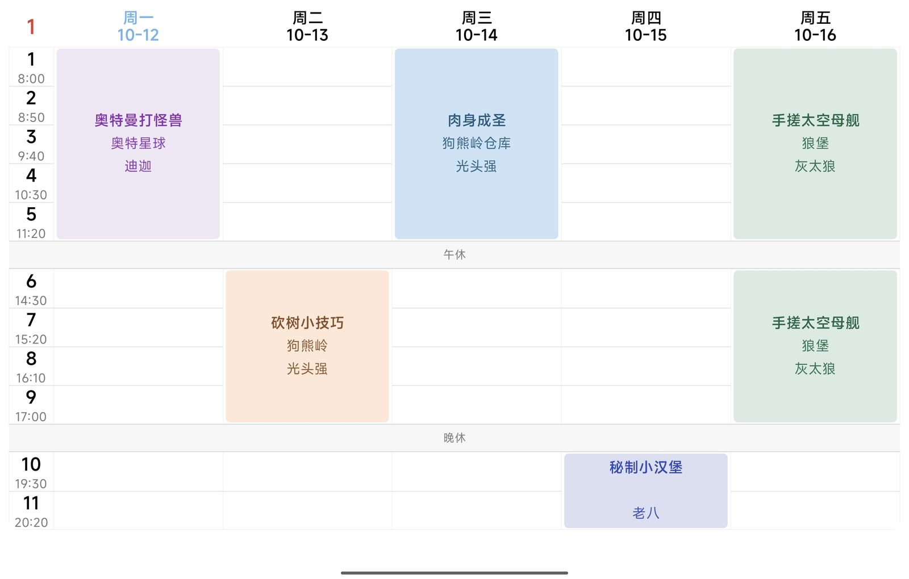
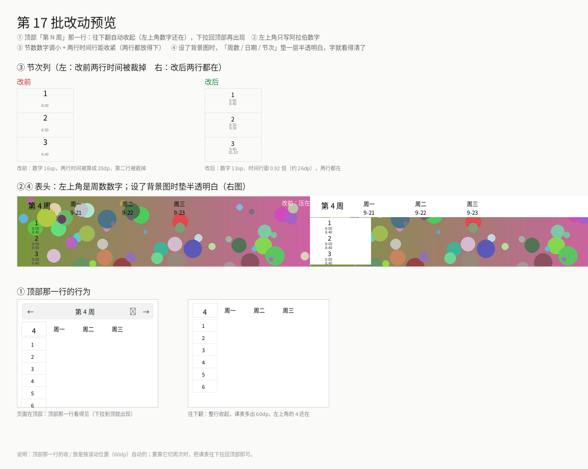
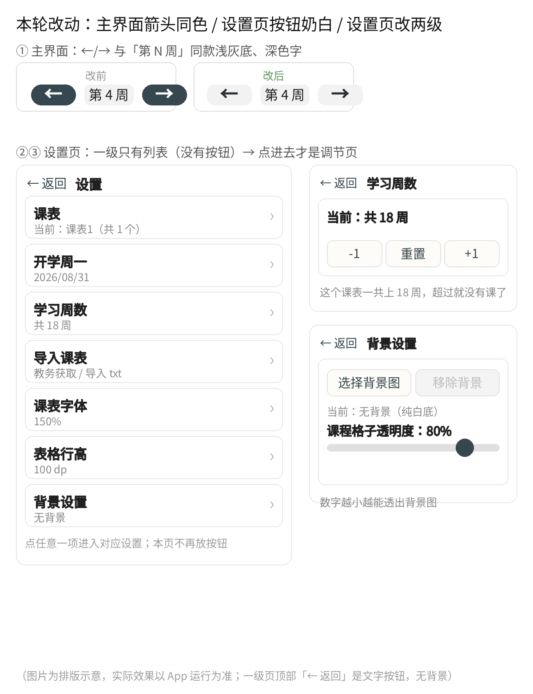
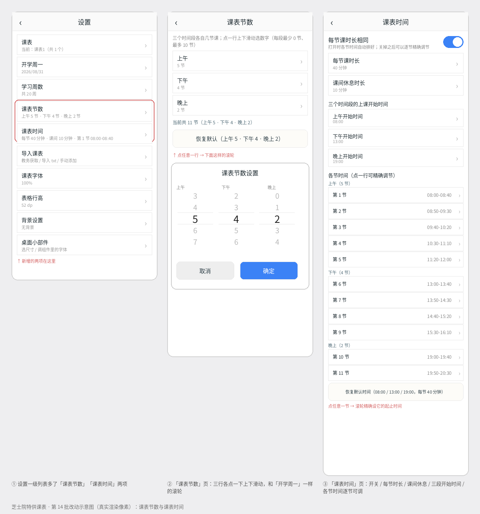
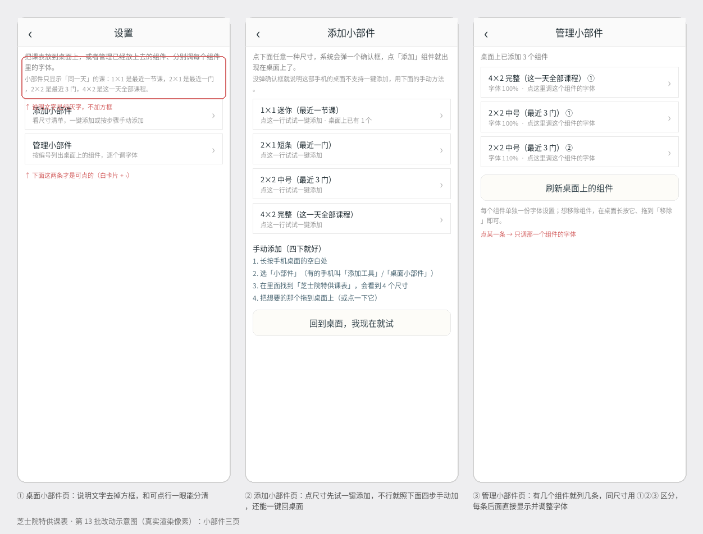
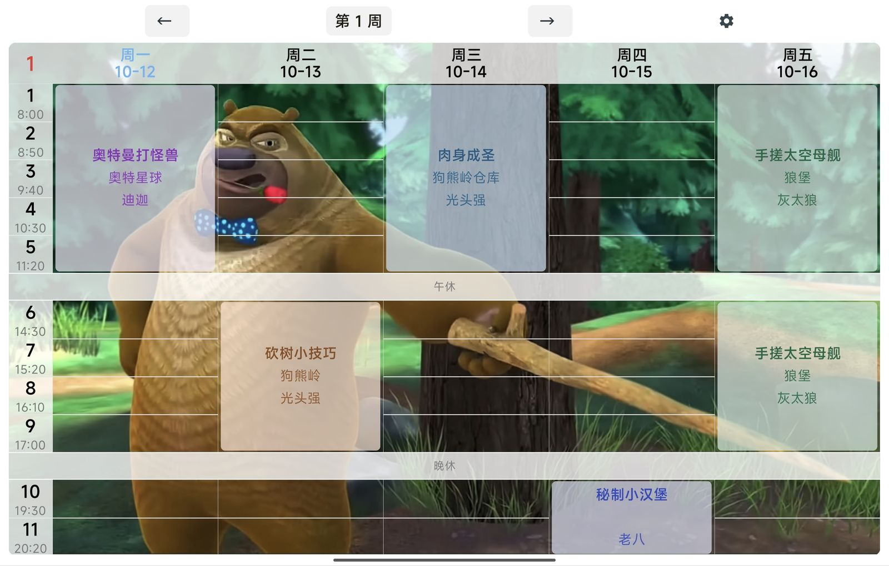

# 芝士院特供课表 · cheese-timetable

一个纯本地的 Android 课程表 App（Kotlin + Jetpack Compose），附带四种尺寸的桌面小部件。
除了「教务获取」要连学校教务系统之外，其他功能全部离线可用。

> 包名 `com.example.myproject`　应用名「芝士院特供课表」　versionName 3.9.1 / versionCode 3

## 界面预览

| 课表主界面 | 顶栏与节次列 |
|---|---|
|  |  |

| 设置页 | 课表时间设置 |
|---|---|
|  |  |

| 桌面小部件 | 配色 |
|---|---|
|  |  |

## 功能

**课表**
- 表格按上午 / 下午 / 晚上三段显示，中间用「午休 / 晚修」分隔条
- 节数、每节课时间、课间休息都可自己调（默认上午 8:00 / 下午 14:30 / 晚上 19:30）
- 跨段的课（比如 1~11 节）自动按段拆成几个独立格子
- 今天高亮（浅蓝字），上下周切换：左右滑动 / ←→ 按钮 / 点「第 N 周」弹周次面板 / 双击表头回本周
- 字体缩放、表格行高、节次列宽度、背景图 + 课程格子透明度、边界透明度

**多课表与导入**
- 多套课表，每套各自记录开学时间与学习周数
- 导入方式：教务系统获取（可开自动更新，一天一次）、导入 txt、分享码（`ZSKB1:` + Base64）
- 课程冲突检测（星期 + 节次 + 周次三重判定）

**上课提醒 / 上课静音**
- 到点发系统通知（可全屏弹窗、锁屏可见），支持提前量设置、开机自动重排
  - 注意：**声音由系统通知通道决定** —— App 自己不会发声，想响铃就到系统「通知设置」里挑铃声
- 上课时自动静音、下课时恢复（需要勿打扰访问权限）

**桌面小部件**（四种尺寸：4×2 / 2×2 / 2×1 / 1×1）
- 只显示还没上完的课；今天上完 → 预告明天；明天也没课 → 「今日课程已上完」
- 每种尺寸的背景（白色 / 透明 / 自定义图片）与 7 类颜色（周数、日期、格子、分割线、时间、课程名、其他）都能单独调
- 字体大小、行高实时可调；「下课闹钟」到点自动重画

## 下载安装包

四个历史版本的 APK（点击进 Release 页面下载），安装包与源码版本对应：

| 版本 | 安装包 | 大小 |
|---|---|---|
| 2.0 | [`cheese-timetable-2.0.apk`](https://github.com/LUO-LGTM/cheese-timetable/releases/download/v2.0/cheese-timetable-2.0.apk) | 7.41 MB |
| 3.7.3 | [`cheese-timetable-3.7.3.apk`](https://github.com/LUO-LGTM/cheese-timetable/releases/download/v3.7.3/cheese-timetable-3.7.3.apk) | 7.93 MB |
| 3.10.5 | [`cheese-timetable-3.10.5.apk`](https://github.com/LUO-LGTM/cheese-timetable/releases/download/v3.10.5/cheese-timetable-3.10.5.apk) | 8.08 MB |
| 3.11.8 | [`cheese-timetable-3.11.8.apk`](https://github.com/LUO-LGTM/cheese-timetable/releases/download/v3.11.8/cheese-timetable-3.11.8.apk) | 8.13 MB |

全部版本页：<https://github.com/LUO-LGTM/cheese-timetable/releases>

> 手机上下载 `.apk` 后直接点击安装即可；若系统提示「未知来源应用」，去设置里允许一次。
> 注意：这些 APK 里仍然包含「支持作者」页的收款码图片（本仓库的源码里已替换成占位图，但已打包的 APK 无法修改）。

## 构建

需要 **Android Studio**（Ladybug 或更新的版本）+ **JDK 17**。

```
- AGP           8.5.2
- Kotlin        2.0.20（含 Compose 编译器插件）
- Gradle        8.9
- compileSdk    34
- minSdk        26（代码用到 java.time）
- targetSdk     34
- Compose BOM   2024.09.00（Material3 / Foundation / UI / Activity-Compose 1.9.2）
```

用 Android Studio 打开仓库根目录即可（首次会自动补 `gradlew` 与 wrapper jar）。

> ⚠️ 说明：本项目的源码原本是在手机端 IDE（CodeAssist）里写的，那边的构建描述是 `module.toml`（IDE 私有文件，未包含在本仓库中）。
> 这里的 `settings.gradle.kts` / `build.gradle.kts` / `app/build.gradle.kts` 等文件是**后补的等价 Gradle 骨架**，方便在电脑上用 Android Studio 打开；
> 如果首次构建报依赖或版本相关的错，按提示微调即可（本机没条件编译验证，只能保证配置项与源码实际用到的东西对齐）。

## 目录结构

```
app/src/main/
├── AndroidManifest.xml
├── kotlin/com/example/myproject/
│   ├── MainActivity.kt              # 全部界面 + 逻辑（课表、设置页、提醒、导入导出…）
│   └── ScheduleWidgetProvider.kt    # 桌面小部件（4 种尺寸 + 下课闹钟）
└── res/
    ├── drawable/                    # 图标、课程格子底色（widget_cell_c0~c19）、小部件背景
    ├── layout/                      # 4 种尺寸的小部件布局
    ├── mipmap*/                     # 启动图标
    ├── values/                      # colors / strings / themes
    └── xml/                         # 4 种尺寸的小部件配置（appwidget-provider）
```

## 隐私与免责

- 教务系统的账号密码**只在本机加密保存**（Android Keystore 生成密钥 + AES-GCM），不会上传到任何服务器；
  拉课表是直接请求学校教务系统的接口。
- 「支持作者」页里的收款码图片**未包含**在本仓库中：为了保护隐私，`support_wechat` / `support_alipay` 两张图已替换成**空白占位图**（保留原资源名，这样源码里的 `R.drawable` 引用仍然有效、构建不会报错），
  所以设置里的「支持作者」页在本地构建时只会看到两块空白方格。
- 注：目前 Manifest 里把启动图标临时指向了 `drawable/tut`（一张教程图），所以 `tut.png` 不能删。
- 本 App 与任何学校官方均无关，仅供个人学习使用。

## 许可

暂未指定开源许可证（All rights reserved）。如需转载或二次使用，请先联系作者。
